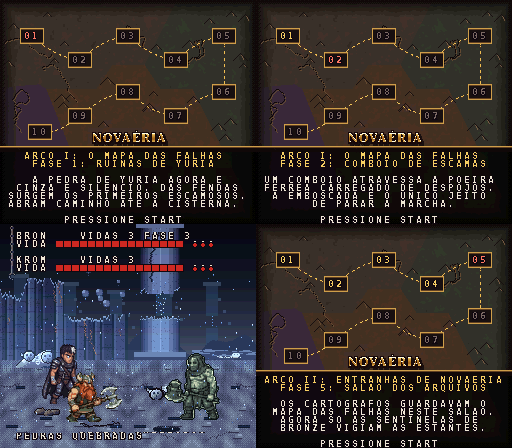
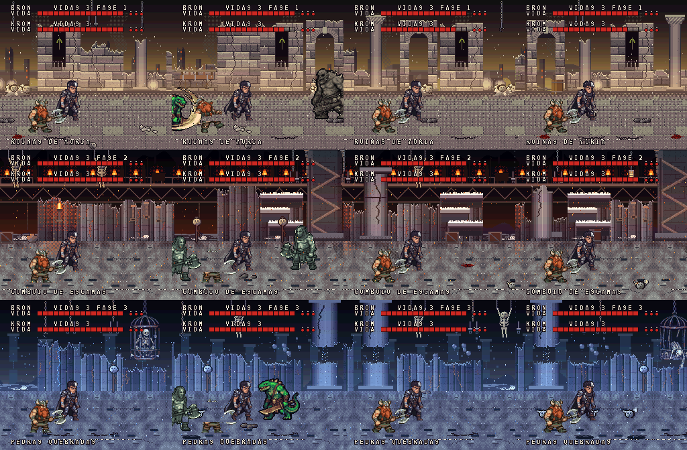
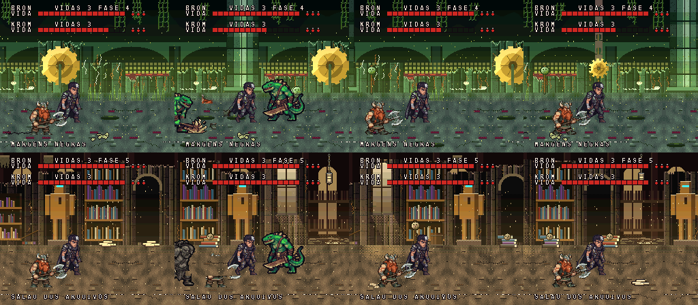
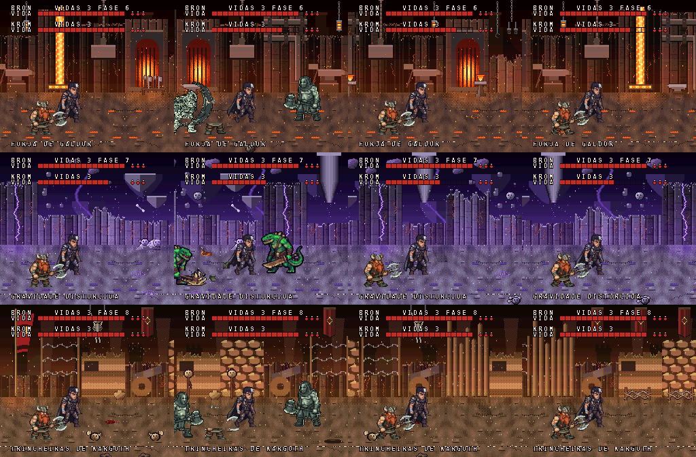
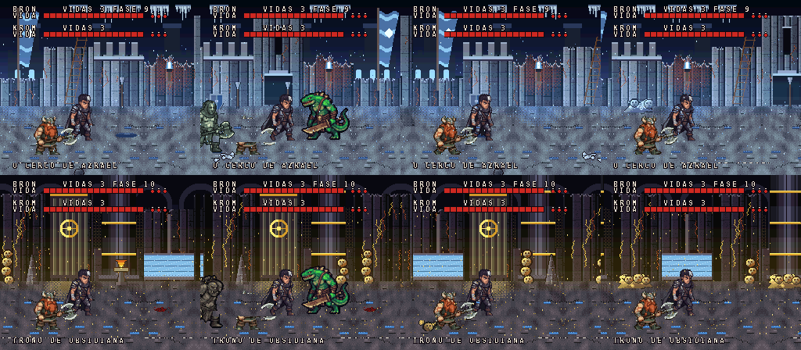
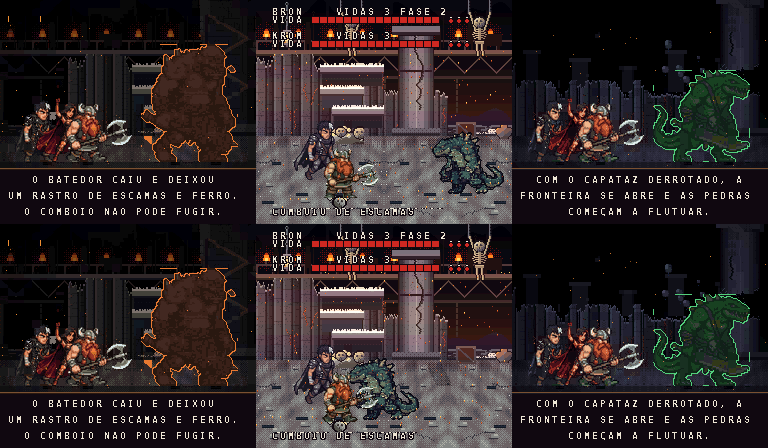

# Novaéria: O Peso das Cinzas

**Um beat'em up gratuito para Super Nintendo**, baseado no livro *Novaéria: O Peso das Cinzas*, de Bruno A. Dias. Inspirado em Golden Axe II, escrito do zero em assembly 65816.

`Super Nintendo` · `65816 + SPC700` · `ROM de 2 MB (LoROM, FastROM)` · `Distribuição gratuita` · `Versão 0.25`

## O jogo

- **3 heróis jogáveis:** Bron (equilibrado), Valkis (rápida, magia de fogo) e Krom (lento e forte).
- **1 ou 2 jogadores** no mesmo console, com retorno do parceiro eliminado.
- **10 fases** em quatro arcos, de *Ruínas de Yuria* ao *Trono de Obsidiana*, cada uma com chefe próprio e a batalha final contra Vorn em três formas.
- **9 cenas ilustradas** entre as fases e um mapa da campanha com narração.
- **Combate fluido:** combos que cancelam ao acertar, buffer de entrada, hitstop e tremor de tela.
- **Menu OPÇÕES** com dificuldade, vidas, redução de flashes e **CHEATS** (pulo duplo, vida infinita, magia infinita, hit kill), salvos na SRAM.
- **Trilha original** com o Terrific Audio Driver.

| | |
|---|---|
|  |  |
|  |  |

## Como jogar

- **No navegador:** [versão web](https://bruno-a-dias.github.io/novaeria/) (EmulatorJS, funciona também no celular).
- **Windows:** baixe `Novaeria.exe` na aba *Releases* e abra. Não precisa instalar nada.
- **Android:** APK na aba *Releases*.
- **Emulador de SNES** (Snes9x, bsnes, Mesen): abra o arquivo `.sfc` da aba *Releases*.
- **Flashcart (SD2SNES / FXPAK):** copie o `.sfc` para o cartão.

### Controles

| Botão | Ação |
|---|---|
| Direcional | Andar (toque duplo corre) |
| Y | Atacar (3 golpes em combo) |
| B | Pular (Y no ar: golpe aéreo) |
| X | Giro |
| A | Magia |
| START | Confirmar e pausar |

## Sobre

Criado por **Bruno A. Dias** (@badmask_84), professor do IESB, a partir do universo do seu livro. O jogo é gratuito. Este repositório reúne divulgação, imagens e a versão jogável na web; o código-fonte é mantido em repositório privado.

Próximo passo planejado: a DLC **"O Beijo da Morte"**, com 5 fases dedicadas à Vilã e variações vampirescas.

---

*Novaéria: O Peso das Cinzas é uma obra independente. Não é afiliado nem endossado por Nintendo ou SEGA. "Super Nintendo" e "Golden Axe" pertencem aos respectivos donos.*
